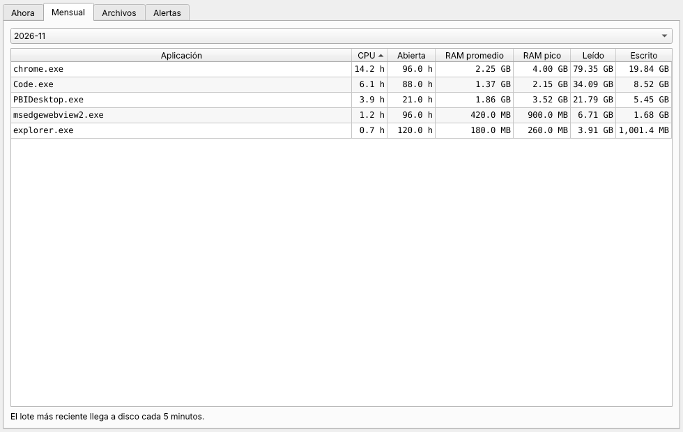

# Huella

[Español](README.md) · **English** · [Portfolio page](https://johangb.github.io/en/projects/huella.html)

  

A passive, read-only profiler for Windows and Linux. It sits hidden in the system tray,
records resource use per application and detects memory leaks and processes with
sustained CPU. Its design principle: do not spend the resources it is trying to measure.
*Huella* is Spanish for "footprint".

**Status:** core, tray and dashboard are complete and tested on Linux. The Windows code
paths were only tested with test doubles, **not on a real Windows machine** (see Limitations).



## Usage

```bash
pip install -r requirements.txt
python tray.py                  # tray; double click opens the dashboard
python daemon.py -v             # headless (Linux without a desktop)
python tools/bench.py           # measures what Huella costs YOUR machine
```

To start it with Windows, create a shortcut to `pythonw.exe C:\path\tray.py` in
`shell:startup`. Huella does not do this itself: touching system startup would break the
read-only principle.

To change thresholds, such as the N minutes of CPU, create `huella.json` in the data folder
(`%LOCALAPPDATA%\Huella` or `~/.local/share/huella`):

```json
{"hot_minutes": 8, "hot_core_pct": 90, "leak_window_min": 45}
```

## Thread architecture

One clock and one pipeline. This is the central decision of the project.

| Thread | Does | Waits on | Timeout |
| --- | --- | --- | --- |
| Main | Tray and dashboard | Qt event loop | None while the dashboard is closed |
| `collector` | `Sampler.sample()`, publishes `Snapshot` | `Gate.wait_turn` | **Yes, the only one** |
| `analyzer` | Detectors, daily aggregate, decides the batch every 5 min | `queue.get()` | None |
| `writer` | SQLite transactions, retries | `queue.get()` | None |
| `scan` | Walks folders on demand | 50 % duty cycle | Only while running |

**Why psutil does not freeze the tray.** Qt runs on the main thread and never calls psutil.
With 468 processes and the collector in a continuous loop, the main thread had a p99 delay
of 0.88 ms and a maximum of 6.83 ms. Background threads never touch widgets: they notify
through Qt signals, which are queued on the main thread.

**Why Gaming mode reaches zero.** Only `collector` has a timer. It finishes its tick and sends
`QUIESCE`; `analyzer` flushes the aggregate and `writer` commits the last batch; then
`collector` blocks on `Condition.wait()` **without a timeout**. Nobody runs
`while paused: sleep(1)`.

**Smart polling.** 10 s if global CPU is above 40 %, 15 s otherwise, and a 2 % duty-cycle cap.

## Technical decisions

- **`cpu_times()` deltas, not `cpu_percent()`.** A cumulative counter loses no work when a
  tick is late. The `(pid, create_time)` key avoids mixing processes when a PID is reused.
- **CPU measured in cores, not global percent.** On 16 logical cores a stuck thread is only
  6 % global but keeps one core hot. `hot_core_pct = 90` means 90 % of one core.
- **Private memory, not RSS.** Private Bytes on Windows; `rss - shared` on Linux, because USS
  cost about 27 times more in the measurement.
- **A leak is three conditions** on the per-minute *minimum* over 30 minutes: growth of at
  least 64 MB and 10 %; Kendall tau ≥ 0.70; and a Theil-Sen slope over the last third of at
  least 33 % of the total, which separates a leak from a cache that fills up. No NumPy.
- **Aggregates, not samples.** One row per application per batch; the month is a `GROUP BY`.
- **WAL + `synchronous = NORMAL`.** A power cut can lose the last batch but not corrupt the database.
- **Read-only is tested, not promised.** `tests/test_readonly.py` walks the AST and fails if
  `kill`, `terminate`, `suspend`, `nice`, `subprocess`, `socket` and similar appear. The
  dashboard opens SQLite with `mode=ro`.

## Measured results

Linux VM, 2 vCPU, Python 3.13, psutil 7.2. **These are Linux figures:** run
`python tools/bench.py` on your own machine.

| Measure | Result |
| --- | --- |
| Tick with 67 processes | 4.2 ms CPU, 0.028 % of one core at 15 s |
| Tick with 468 processes | 22 ms CPU |
| Daemon running, 5 real minutes | 0.04 % CPU, 22.6 MB RSS, 4 threads |
| Tray running, 5 real minutes (Qt `offscreen`) | 0.04 % CPU, 50.9 MB RSS |
| **Gaming mode, daemon, 5 min** | **0 ms CPU, 0 context switches, 0 KB written** |
| **Gaming mode, tray, 5 min** | **0 ms CPU, 1 context switch, 0 KB written** |
| Memory after 20,000 ticks with processes starting and stopping (≈3.5 days) | 23.3 → 23.4 MB |

**SSD wear.** The real daemon, observed from outside, wrote 20 KB every 5 minutes: about
5.8 MB a day. `tools/bench_disk.py` simulates a day with 60 applications: 1.15 MB requested
with aggregates versus 173.6 MB with one row per process and tick, 151 times less.

Leak detection on 5,000 synthetic 30-minute series (`tools/calibrate.py`):

| Scenario | Should alert | Alerted |
| --- | --- | ---: |
| 3–4 MB/min leak with noise | Yes | 99.4 % |
| Stepwise leak | Yes | 100 % |
| Leak over a GC sawtooth | Yes | 100 % |
| Stable, plateauing cache, flat sawtooth, single step | No | 0 % |
| Random walk (σ = 8 and 25 MB/min) | No | 2.3 % and 6.1 % |

## Limitations

- **Windows untested.** Private Bytes, pseudo-processes, `st_birthtime`, OneDrive and
  junctions were validated with mocks. Gaming mode's zero must also be confirmed there.
- **Zero CPU, not zero RAM.** In Gaming mode the process stays loaded in memory.
- **The tray weighs more than the daemon.** PyQt6 adds about 28 MB; opening the dashboard
  adds about 14 MB more that is not returned when it closes.
- **No temperature on Windows.** psutil only exposes it on Linux.
- **Passive sampling.** A process that starts and ends between two ticks is not seen.
- **Leaks per PID, not per application**, and a process needs 30 minutes alive to be evaluated.
- **False positives are possible**, as the random walk shows. Thresholds were calibrated on
  synthetic series, not real applications.
- **No administrator rights.** Some protected processes return `AccessDenied`.
- **Up to 5 minutes lost** on an abrupt shutdown.
- **The database is not encrypted.** It stores process names and file paths, locally.
  Huella makes no network connections.

## Tests

```bash
pip install -r requirements.txt -r requirements-dev.txt
pytest
```

117 tests on Python 3.10 and 3.13, including the test with real processes. They have not
been run on Windows.
