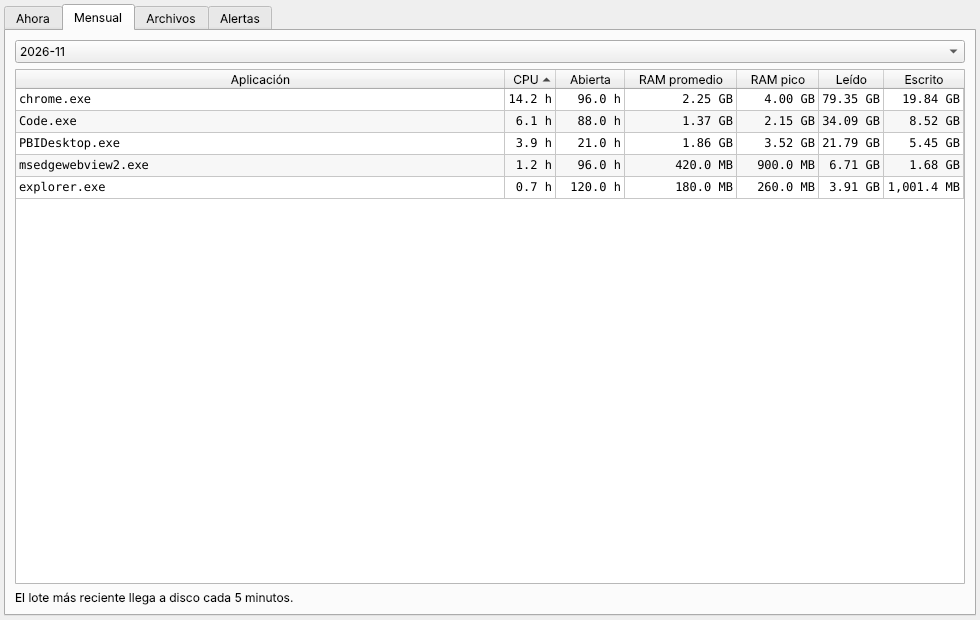

# Huella

**Español** · [English](README.en.md) · [Ficha en el portafolio](https://johangb.github.io/proyectos/huella.html)

  

Profiler pasivo de solo lectura para Windows y Linux. Vive oculto en la bandeja del
sistema, registra el consumo por aplicación y detecta fugas de memoria y procesos con CPU
sostenida. Su principio de diseño: no gastar los recursos que intenta medir.

**Estado:** núcleo, bandeja y panel completos y probados en Linux. Las ramas de Windows
solo se probaron con dobles de prueba, **no en un Windows real** (ver Limitaciones).



## Uso

```bash
pip install -r requirements.txt
python tray.py                  # bandeja; doble clic abre el panel
python daemon.py -v             # sin interfaz (Linux sin escritorio)
python tools/bench.py           # mide lo que Huella le cuesta a TU equipo
```

Para que inicie con Windows, crea en `shell:startup` un acceso directo a
`pythonw.exe C:\ruta\tray.py`. Huella no lo hace por sí misma: tocar el arranque del
sistema contradiría el principio de solo lectura.

Para cambiar umbrales, como la N de los minutos de CPU, crea `huella.json` en la carpeta de
datos (`%LOCALAPPDATA%\Huella` o `~/.local/share/huella`):

```json
{"hot_minutes": 8, "hot_core_pct": 90, "leak_window_min": 45}
```

## Arquitectura de hilos

Un solo reloj y una tubería. Es la decisión central del proyecto.

```
 HILO PRINCIPAL (Qt)            Solo eventos. No llama a psutil ni escribe en SQLite.
   │  set_gaming · poke · start_scan              ▲ señales Qt entre hilos
   ▼                                              │
 huella-collector ─cola──▶ huella-analyzer ──cola─▶ huella-writer
 ÚNICO con timeout         get() sin timeout        get() sin timeout
 psutil cada 10-15 s       detectores + acumulado   dueño de la conexión SQLite

 huella-scan                Efímero: nace con "Escanear" y muere al terminar.
```

| Hilo | Hace | Espera en | Timeout |
| --- | --- | --- | --- |
| Principal | Bandeja y panel | Bucle de eventos de Qt | Ninguno con el panel cerrado |
| `collector` | `Sampler.sample()`, publica `Snapshot` | `Gate.wait_turn` | **Sí, el único** |
| `analyzer` | Detectores, acumulado diario, decide el lote cada 5 min | `queue.get()` | Ninguno |
| `writer` | Transacciones SQLite, reintentos | `queue.get()` | Ninguno |
| `scan` | Recorre carpetas bajo demanda | Ciclo útil del 50 % | Solo mientras corre |

**Por qué psutil no congela la bandeja.** Qt corre en el hilo principal y nunca llama a
psutil. El GIL no da paralelismo real, pero se libera cada 5 ms y en las llamadas al
sistema. Con 468 procesos y el recolector en bucle continuo, el hilo principal tuvo un
retraso p99 de 0.88 ms y máximo de 6.83 ms. Los hilos de fondo tampoco tocan widgets:
avisan con señales de Qt, que se encolan en el hilo principal.

**Por qué el modo Gaming llega a cero.** Como solo `collector` tiene temporizador, no hay
varios timers que apagar. El apagado ocurre en este orden:

1. `collector` termina su tick y envía `QUIESCE` por la tubería.
2. `analyzer` vacía el acumulado y `writer` confirma el último lote.
3. `collector` se bloquea en `Condition.wait()` **sin timeout**. Los otros dos ya estaban
   bloqueados en su `get()`. Nadie hace `while pausado: sleep(1)`.

El panel se destruye con su timer y cualquier escaneo se cancela. Al volver, se fija una
línea base nueva: los deltas de un intervalo desconocido no significan nada.

**Polling inteligente.** 10 s si la CPU global pasa del 40 %, 15 s si no, y un tope de 2 %
de ciclo útil: si un tick cuesta 1 s, el siguiente espera 50 s. El tick nunca bloquea en
una cola: si el analizador se atasca, descarta esa muestra.

## Estructura

```
config.py      Umbrales y carpeta de datos
metrics.py  ★  Recolección con psutil: deltas, memoria privada, Snapshot
daemon.py   ★  Hilos, Gate, tubería, modo Gaming
anomalies.py   Detectores y acumulado diario. Lógica pura
storage.py     Escritor por lotes y lector de solo lectura
scanner.py     Top N de archivos pesados, solo metadatos
tray.py        Bandeja. Punto de entrada
dashboard.py   Panel. Se importa con el primer doble clic y se destruye al cerrar
tools/         bench.py, bench_disk.py, calibrate.py
```

## Decisiones técnicas

**Deltas de `cpu_times()`, no `cpu_percent()`.** Un contador acumulado no pierde trabajo si
el tick llega tarde, y el histórico necesita CPU-segundos. La clave `(pid, create_time)`
evita mezclar dos procesos cuando el sistema reutiliza un PID.

**CPU medida en núcleos, no en porcentaje global.** En 16 núcleos lógicos, un hilo
atascado es apenas 6 % global, pero calienta un núcleo sin parar. `hot_core_pct = 90`
significa 90 % de un núcleo.

**Memoria privada, no RSS.** En Windows se usa Private Bytes: el Working Set baja cuando el
sistema recorta páginas, justo lo que ocultaría una fuga. En Linux, `rss - shared`, porque
USS exige recorrer `smaps` y costó unas 27 veces más en la medición.

**Una fuga se define por tres condiciones.** Se toma el *mínimo* de cada minuto, para seguir
el piso y no los picos, durante 30 minutos:

- Crecimiento de al menos 64 MB y 10 %.
- Tau de Kendall ≥ 0.70: sube de forma monótona.
- La pendiente de Theil-Sen del último tercio es al menos 33 % de la total: no se aplanó.

La última es la que separa una fuga de una caché que se llena. Theil-Sen y Kendall son
robustos a picos aislados, y el filtro de crecimiento evita ordenar nada para la mayoría
de los procesos. Sin NumPy: importarlo sumaría unos 15 MB a un demonio de 23 MB.

**CPU sostenida con histéresis.** Un bajón breve no reinicia la racha: se tolera hasta 10 %
del tiempo por debajo del umbral. A mitad de racha se toma una foto de los hilos, y al
alertar se resta para nombrar el hilo dominante. Esa lectura solo ocurre con sospechosos.

**Agregados, no muestras.** Entre lotes, los datos viven en un diccionario `(día, app)`.
Un lote tiene una fila por aplicación sin importar cuántos ticks pasaron, y la base crece
con apps × días. El mes sale de un `GROUP BY`, sin segunda tabla.

**WAL + `synchronous = NORMAL`.** Sin `fsync` por commit, solo en el checkpoint. Un corte
de energía puede perder el último lote, pero no corrompe la base.

**Fecha de creación real.** En Linux `st_ctime` es el último cambio de metadatos. Huella
llama a `statx(2)` por `ctypes` para leer el btime. Si el sistema de archivos no lo guarda,
muestra `—` en lugar de inventar una fecha.

**El escáner respeta la nube y los enlaces.** Omite los marcadores de OneDrive, que aparentan
un tamaño que no está en disco, y las uniones de carpeta, que pueden formar bucles. Las
carpetas de OneDrive también son puntos de reanálisis, así que se filtra por etiqueta para
no saltárselas. Nunca abre un archivo.

**Solo lectura comprobado, no prometido.** `tests/test_readonly.py` recorre el AST y falla
si aparece `kill`, `terminate`, `suspend`, `nice`, `subprocess`, `socket` y similares. El
panel lee por `mode=ro`, de modo que SQLite rechaza cualquier escritura. Por la misma regla
Huella no baja su propia prioridad.

## Resultados medidos

VM Linux de 2 vCPU, Python 3.13, psutil 7.2. **Son cifras de Linux:** en Windows cada
lectura de proceso es distinta, así que corre `python tools/bench.py` en tu equipo.

| Medida | Resultado |
| --- | --- |
| Tick con 67 procesos | 4.2 ms de CPU, 0.028 % de un núcleo a 15 s |
| Tick con 468 procesos | 22 ms de CPU |
| Demonio activo, 5 min reales | 0.04 % de CPU, 22.6 MB de RSS, 4 hilos |
| Bandeja activa, 5 min reales (Qt `offscreen`) | 0.04 % de CPU, 50.9 MB de RSS |
| **Modo Gaming, demonio, 5 min** | **0 ms de CPU, 0 cambios de contexto, 0 KB escritos** |
| **Modo Gaming, bandeja, 5 min** | **0 ms de CPU, 1 cambio de contexto, 0 KB escritos** |
| Memoria tras 20 000 ticks con procesos naciendo y muriendo (≈3.5 días) | 23.3 → 23.4 MB |

**Desgaste del SSD.** El demonio real, observado desde afuera, escribió 20 KB cada 5
minutos: unos 5.8 MB al día. Para comparar métodos, `tools/bench_disk.py` simula un día
con 60 aplicaciones y cuenta los bytes pedidos al sistema:

| Método | Pedido por día | Base tras 1 día |
| --- | ---: | ---: |
| Huella: agregados cada 5 min | 1.15 MB | 16 KB |
| Una fila por proceso y tick (200 procesos) | 173.6 MB | 32.3 MB |

Son 151 veces menos. La simulación da menos que el demonio real porque no incluye el
redondeo a páginas del sistema de archivos, así que la cifra útil para el SSD es la de 5.8
MB, y la de la tabla sirve solo para comparar. Tras 30 días simulados la base ocupa 0.11 MB.

Detección de fugas sobre 5 000 series sintéticas de 30 minutos (`tools/calibrate.py`):

| Escenario | Debería alertar | Alertó |
| --- | --- | ---: |
| Fuga de 3 a 4 MB/min con ruido | Sí | 99.4 % |
| Fuga con escalones | Sí | 100 % |
| Fuga sobre sierra de GC | Sí | 100 % |
| Estable, caché que se aplana, sierra plana, escalón único | No | 0 % |
| Paseo aleatorio (σ = 8 y 25 MB/min) | No | 2.3 % y 6.1 % |

También hay una prueba con procesos reales y tiempo comprimido: una fuga y un bucle
infinito se detectan, mientras que una caché y un proceso en reposo no.

## Limitaciones

- **Windows sin probar.** `Private Bytes`, los pseudoprocesos, `st_birthtime`, OneDrive y
  las uniones se validaron con objetos simulados. El cero del modo Gaming también debe
  confirmarse allí: una ventana Qt de bandeja puede recibir mensajes del sistema.
- **Cero de CPU, no cero de RAM.** En modo Gaming el proceso sigue cargado en memoria. Salir
  de Huella es la única forma de liberar esa RAM.
- **La bandeja pesa más que el demonio.** PyQt6 suma unos 28 MB al demonio. Abrir el panel
  suma cerca de 14 MB más, que no vuelven al sistema al cerrarlo. Medido con Qt `offscreen`,
  sin una bandeja real.
- **Sin temperatura en Windows.** psutil solo la expone en Linux. En Windows, "calentamiento"
  significa CPU sostenida, no grados medidos.
- **Muestreo pasivo.** Un proceso que nace y muere entre dos ticks no se ve, y el consumo
  final de uno que termina se pierde.
- **Fugas por PID, no por aplicación.** Una fuga repartida entre muchos procesos que se
  reinician no forma una serie continua. Y un proceso necesita 30 minutos vivo para evaluarse.
- **Falsos positivos posibles.** Un proceso cuya memoria vaga sin patrón puede disparar la
  alerta, como muestra el paseo aleatorio. Los umbrales se calibraron con series sintéticas,
  no con aplicaciones reales. Revísalos tras unas semanas de uso.
- **Sin permisos de administrador.** Algunos procesos protegidos devuelven `AccessDenied`: se
  conservan con los campos disponibles. En Linux no se ven las E/S de otros usuarios.
- **Hasta 5 minutos de pérdida** ante un cierre abrupto. Un cierre normal guarda todo.
- **Doble clic en Linux.** Algunos escritorios no entregan ese evento a la bandeja. El menú
  contextual tiene "Abrir panel". Sin bandeja disponible, el panel se abre al iniciar.
- **La base no está cifrada.** Guarda nombres de procesos y rutas de archivos, en local.
  Huella no hace ninguna conexión de red.

## Pruebas

```bash
pip install -r requirements.txt -r requirements-dev.txt
pytest
```

117 pruebas en Python 3.10 y 3.13, con SQLite 3.53, incluida la prueba con procesos reales.
En Windows no se han ejecutado. En la CI de GitHub (Ubuntu, Python 3.11) pasan las 117, pero `tests/test_daemon.py::test_callback_receives_alerts` es intermitente: falló en la primera ejecución y pasó en la siguiente. Depende de tiempos reales y está pendiente de revisar.
